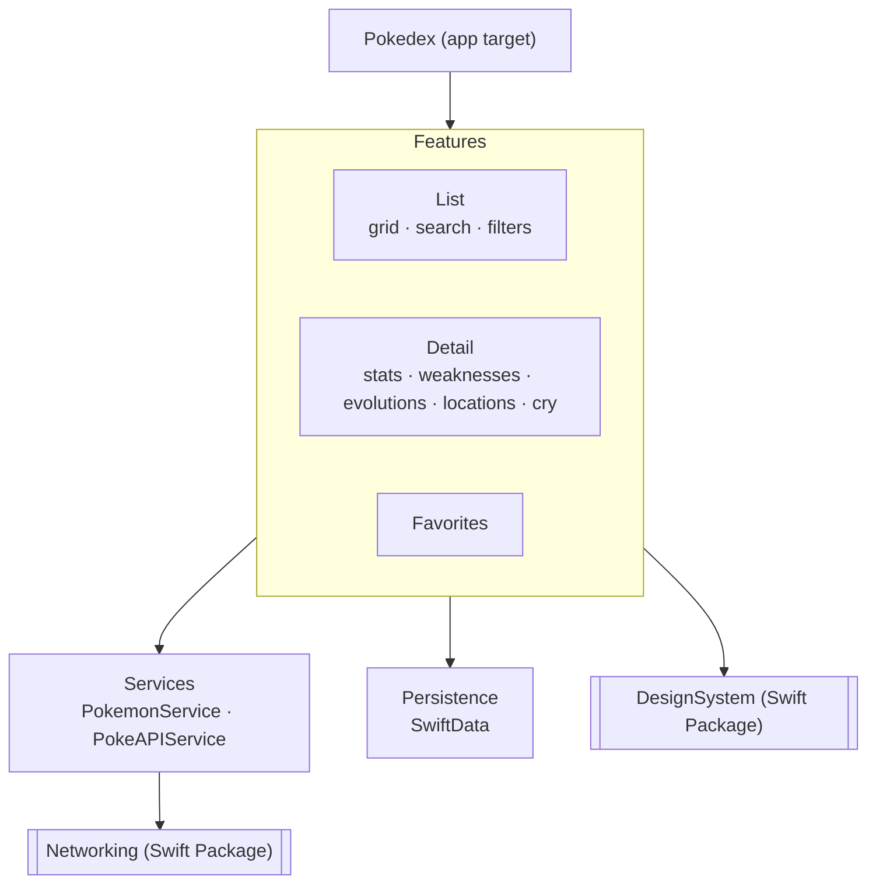

# Architecture

Pokédex for iOS 17+, written in SwiftUI with Swift 6 strict concurrency. Data comes from [PokéAPI](https://pokeapi.co).

## Overview



There are two local Swift Packages. Everything else lives in the app target, organised by folder.

| Part | Kind | Why |
|---|---|---|
| `Networking` | Swift Package | Generic HTTP layer, reused by the Weather and Movies apps |
| `DesignSystem` | Swift Package | Cannot import the domain, so components take plain values and stay previewable |
| `Models`, `Services`, `Persistence`, `Features/*` | App target folders | Splitting them adds nothing at this size |

## Repository layout

```
Pokedex/
  App/            PokedexApp, RootView (TabView), SplashVideoView
  Models/         Pokemon, PokemonType, Stat, EvolutionChain, Location…
  Services/       PokemonService (protocol), PokeAPIService, DTOs, mappers
  Persistence/    SwiftData models: FavoritePokemon, PokemonIndexEntry
  Features/
    List/         PokemonListView, PokemonListViewModel
    Detail/       PokemonDetailView, PokemonDetailViewModel, CryPlayer
    Favorites/    FavoritesView, FavoritesViewModel
  Resources/      SplashLight.mp4, SplashDark.mp4
Packages/
  Networking/
  DesignSystem/
PokedexTests/
PokedexUITests/
```

## Layers

```
View (SwiftUI)
  → ViewModel (@MainActor @Observable)
    → PokemonService (protocol)
      → PokeAPIService
        → HTTPClient (Networking)
          → ResponseCache (actor) → URLSession
```

- **Views** render a `ViewState` and send user intents to the ViewModel. They contain no logic.
- **ViewModels** are `@MainActor @Observable`. Each one exposes `state: ViewState<T>` and receives its dependencies through `init`. There is no DI container.
- **`PokemonService`** is the contract the features depend on. `PokeAPIService` implements it over REST. A GraphQL implementation will come later, behind the same protocol.
- **DTOs** (`Decodable`, shaped like the API) are mapped to **domain models** (`Sendable` structs). Only the mappers know the API's shape.

```swift
enum ViewState<Value> {
    case idle, loading, loaded(Value), empty, failed(AppError)
}
```

`ViewState` covers the design's loading, empty, error and no-results screens.

## Networking (package)

- `Endpoint` protocol: path, method, query items, headers.
- `HTTPClient`: `func send<T: Decodable & Sendable>(_ endpoint: Endpoint) async throws -> T`, built on `URLSession` async/await.
- `APIError`: `offline`, `notFound`, `server(statusCode:)`, `decoding(Error)`, `cancelled`.
- `ResponseCache` (actor):
  - `NSCache<NSURL, NSData>` for responses. It evicts itself under memory pressure.
  - `[URL: Task<Data, Error>]` for requests in flight. A second caller for the same URL awaits the existing task instead of starting a new request.
- Images go through `URLCache` (memory and disk) configured on the `URLSessionConfiguration`.

The package knows nothing about Pokémon.

## DesignSystem (package)

- **Colors**: `Colors.xcassets` with one colorset per token (`shell`, `viewer`, `surface`, `lcd`, `accent`…), each with Any and Dark appearances, exposed as `Color.shell` and so on. There are 18 type colors.
- **Typography**: JetBrains Mono, bundled and registered with `CTFontManagerRegisterFontsForURL`, exposed as `Font.mono(_:weight:)`. Body text uses SF Pro.
- **Metrics**: `Spacing` and `Radius` enums.
- **Components** (each one has light and dark `#Preview`s):
  - `TypeChip`, `FilterChip`, `StatSegment`, `RegionTab`, `SectionTitle`, `IconButton`, `AccentButtonStyle`
  - `PokemonCard`, `SearchField`, `Readout`, `StatRow`, `EvolutionNode`, `LocationRow`
  - `DeviceTopBar`, `DetailTopBar`, `FilterBar`, `ScanViewer`, `StatsLCD`, `StateMessage`, skeleton modifier
- The app maps domain to design values, for example `extension PokemonType { var color: Color }`.
- The tab bar is the native `TabView` and is not part of the package.

The Figma file's "Design System" page is the source of truth: one component in Figma is one `View` here.

## Data and PokéAPI

| Need | Source | Notes |
|---|---|---|
| Search index | `GET /pokemon?limit=2000` (1351 entries) | Fetched once and stored in SwiftData. Search runs locally on name and number. |
| List page | `GET /pokemon?offset=&limit=20` | Infinite scroll. |
| Card (number, types, art) | `GET /pokemon/{id}` | Loaded per card and served by `ResponseCache`. |
| Type filter | `GET /type/{name}` | Intersected locally with the index. |
| Generation filter | `GET /generation/{id}` | Intersected locally with the index. |
| Weaknesses | `damage_relations` of each type | Multipliers are combined for dual types. |
| Evolutions | `/pokemon-species/{id}` → `evolution_chain` | Chain nodes are loaded in parallel with `TaskGroup`. |
| Locations | `GET /pokemon/{id}/encounters` | Grouped by region. |
| Cry | `cries.latest` (OGG) | Played with AVFoundation. **To verify:** AVFoundation may not play OGG directly. |

## Persistence (SwiftData)

- `@Model PokemonIndexEntry`: id and name, for search.
- `@Model FavoritePokemon`: id, name and types, so the Favorites tab works offline.

## Navigation

`NavigationStack` from list to detail. On iOS 18 it uses `.navigationTransition(.zoom)` behind `if #available(iOS 18, *)`, with the standard push as the fallback. There are no deep links.

## Concurrency

- Swift 6 language mode with complete strict concurrency.
- UI-facing types are `@MainActor`. Shared mutable state lives in actors (`ResponseCache`).
- Models and DTOs are `Sendable` value types.
- Each screen's tasks are cancelled when its view disappears (`.task`).

## Testing

- **Swift Testing**: mappers, weakness calculation, local search and filtering, and ViewModels with a mock `PokemonService`.
- **Networking**: `HTTPClient` and `ResponseCache` tested with a `URLProtocol` stub, including request deduplication.
- **UI test**: list → detail → mark as favorite.

## Later

- GraphQL implementation of `PokemonService` (check the beta endpoint first).
- Shiny artwork.
