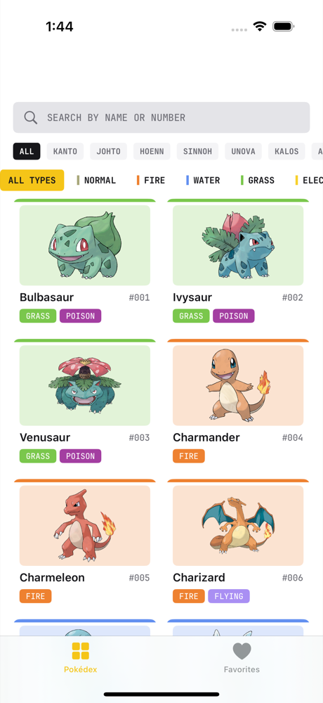
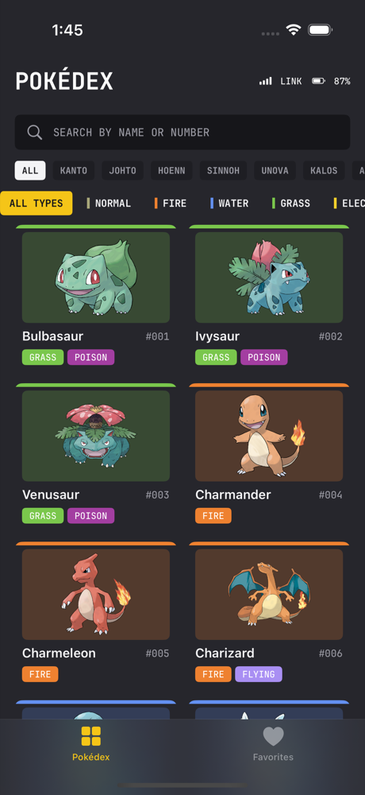
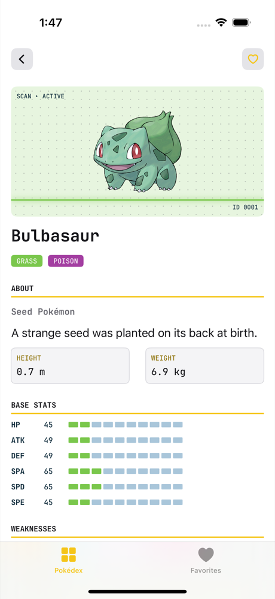
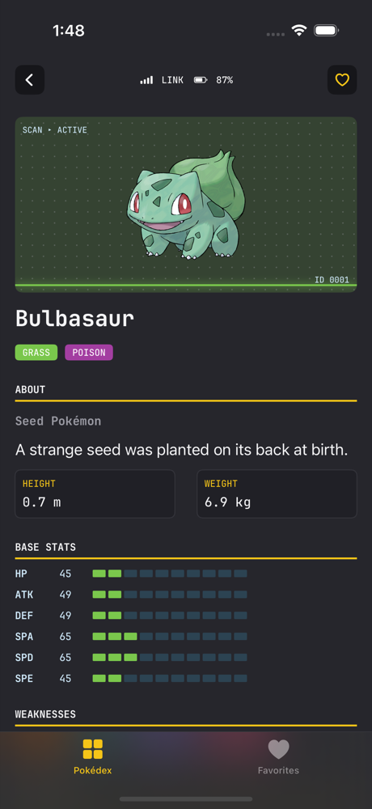

# Pokédex

A Pokédex for iOS built with SwiftUI and Swift 6 on top of [PokéAPI](https://pokeapi.co).

## What it does

- **List.** A grid of every Pokémon:
  - Search by name or number.
  - Filter by region and by type.
  - Infinite scroll.
- **Detail.** Each Pokémon's page shows:
  - Artwork, types, height and weight, and base stats.
  - Weaknesses (combined for dual types) and the evolution chain, whose stages can be tapped.
  - Where to find it in the games, and its cry on iOS 18.4 or later.
  - Each section loads on its own and can be retried on its own.
- **Favorites.** Save a Pokémon from its detail screen and find it in the Favorites tab. The tab works offline. Swipe a card to remove it.
- **Splash.** A short intro video, with light and dark versions. It is skipped when Reduce Motion is on.

| | Light | Dark |
|---|---|---|
| List |  |  |
| Detail |  |  |

## Requirements

- Xcode 16 or later
- iOS 17.0 or later
- [XcodeGen](https://github.com/yonaskolb/XcodeGen)

## Getting started

```bash
brew install xcodegen
git clone https://github.com/salvattore315/iOS-Pokedex.git
cd iOS-Pokedex
xcodegen generate
open Pokedex.xcodeproj
```

The Xcode project is not committed. It is generated from `project.yml`, so run `xcodegen generate` again after you pull changes or edit targets.

Launch arguments (set them in the scheme or pass them to `xcrun simctl launch`):

| Argument | Effect |
|---|---|
| `-listSource remote` | The list pages through the PokéAPI list endpoint instead of the local index. See [Decisions](#decisions). |
| `-skipSplash` | Skips the intro video. |
| `-stubNetwork` | Debug builds only. Answers every request from fixtures and keeps SwiftData in memory. Used by the UI tests. |

## Architecture

Three layers, plus two local Swift Packages. [ARCHITECTURE.md](ARCHITECTURE.md) has the details.

```
Presentation   Features/* (SwiftUI views + @MainActor @Observable view models), App/
     ↓
Domain         Models/, UseCases/, the PokemonService and FavoritesRepository protocols, AppError
     ↑
Data           PokeAPIService, DTOs and mappers (Services/), SwiftData stores (Persistence/)
```

- **Presentation.** Views render a `ViewState` (`idle`, `loading`, `loaded`, `empty`, `failed`) and forward user actions to their view model. They hold no logic.
- **Domain.** Plain `Sendable` value types, use cases such as `CalculateWeaknesses`, and the protocols that the features depend on.
- **Data.** Implements those protocols:
  - `PokeAPIService` over REST. Only its mappers know the shape of the JSON.
  - `PokemonIndexStore` and `FavoritesStore`, which are SwiftData `@ModelActor`s.
- **Swift Packages:**
  - `Networking`: a generic HTTP client with a response cache and a request limiter. It knows nothing about Pokémon.
  - `DesignSystem`: color, typography and spacing tokens, and components that take plain values. Each component has light and dark previews, and there is a catalog app target.
- **Dependency injection.** Every dependency goes through `init`. `AppDependencies` builds the graph once at launch and `RootView` passes it down. There is no container and no singleton.
- **Errors.** They are typed from end to end:
  - `Networking` throws `APIError` (`offline`, `timeout`, `http(statusCode:)`, `decoding`…).
  - The service layer converts it to the app's `AppError` (`offline`, `notFound`, `server`, `unexpected`).
  - Screens show `AppError` as a message, with a retry button when retrying makes sense.
- **Concurrency.** The app uses the Swift 6 language mode with complete strict concurrency:
  - UI types are `@MainActor`.
  - Shared mutable state lives in actors.
  - Each screen's work is a `.task` that is cancelled when the view disappears.

## Decisions

- **Two list modes.**
  - The default mode downloads the index of names and IDs once (about 1,350 entries, one request) and stores it in SwiftData. Paging, search and filters then run locally, offline and instantly.
  - `-listSource remote` pages through the API instead. It is kept to compare both approaches. Search and filters still use the local index, because the API cannot filter by name, type or generation.
- **Caching.**
  - `ResponseCache` (an actor) keeps response bodies in an `NSCache`, which evicts itself under memory pressure.
  - It also deduplicates requests in flight: a second caller for the same URL awaits the first request.
  - When every caller of a request has been cancelled, for example cards scrolled off screen, the request is cancelled too.
  - Artwork and HTTP responses also go through a larger `URLCache`, on disk.
- **Request limiter.** At most four requests run at once, and a free slot goes to the waiting request with the highest task priority.
  - Card types load at `.utility` priority, so the detail screen never waits behind dozens of cards.
  - This took the detail screen from about 30 s to about 2 s on a slow connection.
- **Typed throws.** `throws(APIError)` and `throws(AppError)` make every failure explicit at the call site, so the screens can switch over all cases without a generic `catch`.
- **Per-section loading.** Only the Pokémon itself can fail the detail screen. Species, evolutions, weaknesses and locations load in parallel, and each one fails and retries on its own.

## Tests

Run everything in Xcode with ⌘U, or from the command line:

```bash
xcodegen generate
xcodebuild test -project Pokedex.xcodeproj -scheme Pokedex -destination 'platform=iOS Simulator,name=iPhone 16 Pro'
(cd Packages/Networking && xcodebuild test -scheme Networking -destination 'platform=iOS Simulator,name=iPhone 16 Pro')
(cd Packages/DesignSystem && xcodebuild test -scheme DesignSystem -destination 'platform=iOS Simulator,name=iPhone 16 Pro')
```

Run the package tests with `xcodebuild` on a simulator. `swift test` builds them for macOS.

- **Unit tests** (Swift Testing):
  - Mappers, weakness calculation, local search and filtering.
  - The SwiftData stores, with in-memory containers.
  - Every view model, with test doubles injected through `init`.
- **Networking tests:** the HTTP client, the response cache (deduplication and cancellation) and the request limiter, run against a `URLProtocol` stub.
- **UI tests** (XCTest): launch, and the main flow: list → search → detail → mark as favorite → Favorites tab → remove.
  - They launch the app with `-stubNetwork` and answer every request from the JSON files in `PokedexUITests/Fixtures`, so they never depend on PokéAPI.
  - SwiftData is kept in memory, so every run starts from a clean state.
